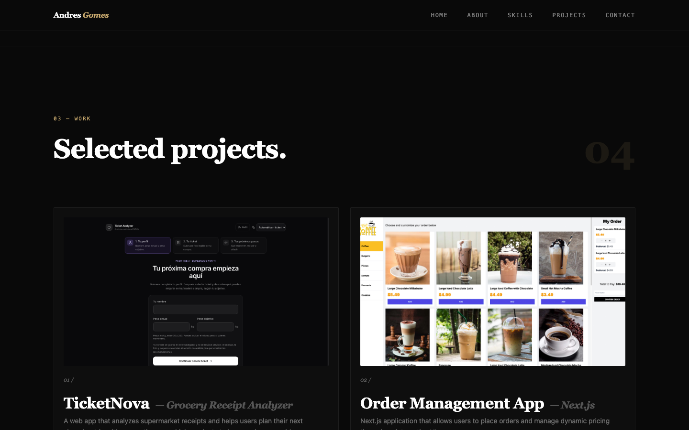

# Andres Gomes · Frontend Developer

Portafolio personal construido con **React, TypeScript y Tailwind CSS** para presentar mis proyectos, mi forma de desarrollar interfaces y mis vías de contacto profesional.

Soy desarrollador frontend con formación en Ingeniería Informática y experiencia en desarrollo de producto y consultoría. Trabajo con React y TypeScript, componentes reutilizables, integración de APIs y pruebas automatizadas. Actualmente estoy en España y busco mi próxima oportunidad como desarrollador frontend. Hablo español nativo e inglés intermedio.

[Ver portafolio](https://portfolio-black-nu-37.vercel.app/) · [GitHub](https://github.com/andle18) · [LinkedIn](https://www.linkedin.com/in/andres-gomes-7426723a9/) · [Contacto](mailto:andresgomes18@gmail.com)



*Captura de la versión local actual. La demo publicada puede mostrar una versión anterior hasta el próximo despliegue.*

## Qué puedes encontrar

- Presentación profesional, sección About y habilidades agrupadas por categoría.
- CV en PDF descargable desde la portada y Contacto, junto con teléfono de contacto para llamadas.
- Cuatro proyectos destacados con capturas, acceso a sus demos y botones de GitHub.
- Una página `/projects` con ocho proyectos en total.
- Navegación entre páginas y secciones, con menú móvil y compensación de la cabecera fija al desplazarse.
- Formulario de contacto conectado a EmailJS, con estados de envío, éxito y error y contacto directo por email si falta la configuración.
- Registro de visitas con Vercel Web Analytics en producción, sin eventos personalizados de clic.
- Animaciones de entrada y una bienvenida que se muestra una vez por sesión.

## Proyectos destacados

| Proyecto | Qué permite hacer | Demo |
| --- | --- | --- |
| **TicketNova** | Analizar tickets de supermercado con IA y recibir sugerencias personalizadas para la próxima compra. | [Abrir TicketNova](https://ticketnova-lyart.vercel.app/) |
| **Order Management App** | Explorar un menú y preparar pedidos desde una interfaz construida con Next.js. | [Abrir aplicación](https://kioskly-orcin.vercel.app/order/coffee) |
| **NexoBoard** | Gestionar proyectos y tareas con un tablero Kanban, colaboración y una demo para visitantes. | [Abrir aplicación](https://uptaskfrontend-sage.vercel.app/auth/login) |
| **AI Cocktail Recommender** | Explorar bebidas y obtener sugerencias mediante una API e inteligencia artificial. | [Abrir aplicación](https://drinks-ai-react.vercel.app/) |

El catálogo también incluye [Crypto Tracker](https://cryptotraker-react-zod-typescript.netlify.app/), [Calorie Tracker](https://calorie-traker.netlify.app/), [Expense Tracker](https://expense-tracker-gomes.netlify.app/) y [Weather Forecast](https://euphonious-licorice-2c760b.netlify.app/).

NexoBoard sustituye al antiguo Task Manager e incluye capturas del tablero Kanban, los proyectos y el acceso. Su código está en [andle18/NexoBoard](https://github.com/andle18/NexoBoard); actualmente el repositorio es privado y requiere permiso para verlo.

TicketNova integra la API de Claude de Anthropic. Esa integración pertenece a la aplicación enlazada: este repositorio contiene el portafolio que la presenta y no necesita una clave de IA para ejecutarse.

## Tecnologías de este repositorio

| Área | Herramientas | Uso |
| --- | --- | --- |
| Interfaz | React 19, TypeScript | Componentes y comprobación estática de tipos con modo estricto. |
| Estilos | Tailwind CSS 3 | Diseño adaptable, colores y estilos de los componentes. |
| Navegación | React Router 7 | Rutas `/` y `/projects`, enlaces internos y navegación a secciones. |
| Animación | Framer Motion | Transiciones y aparición de contenido al entrar en pantalla. |
| Componentes e iconos | Headless UI, Heroicons, React Icons | Diálogo de navegación móvil e iconografía. |
| Contacto | EmailJS (`@emailjs/browser`) | Envío de mensajes al correo configurado en la plantilla. |
| Analítica | Vercel Web Analytics | Registro de visitas en producción. |
| Desarrollo | Vite 7, SWC, ESLint | Servidor local, compilación y análisis estático. |
| Despliegue | Vercel | Configuración de reescritura para navegación de una SPA. |

Las tecnologías de los proyectos del catálogo pueden ser distintas de las utilizadas aquí. Algunos proyectos enlazados usan Firebase; el portafolio no depende de Firebase ni necesita un proyecto de ese servicio para ejecutarse.

## Organización y decisiones técnicas

- **Componentes por sección:** presentación, habilidades, proyectos y contacto se mantienen en archivos separados.
- **Rutas independientes:** la portada agrupa las secciones principales; `/projects` muestra el catálogo completo.
- **Navegación a secciones:** enlaces como `/#contact` permiten volver desde el catálogo a una sección concreta de la portada.
- **Envío de contacto:** `src/lib/email.ts` reúne la configuración de EmailJS y el envío de los cuatro campos del formulario.
- **Disponibilidad sin configuración:** si faltan los identificadores de EmailJS, el sitio sigue disponible y el contacto ofrece el enlace de correo mientras deshabilita el envío del formulario.
- **Controles del formulario:** validación en el cliente, campo honeypot y limitación local de reintentos. Estos controles no equivalen a protección en el servidor.
- **Catálogo compartido:** `src/data/projects.ts` reúne los proyectos, demos y repositorios para ambas vistas. `ProjectLinks` presenta los enlaces y `ProjectImage` permite cambiar entre las tres capturas de NexoBoard.
- **Recursos locales:** las capturas se sirven desde `public/`, con carga diferida en las tarjetas de proyectos.

```text
src/
├── components/             # Secciones de la portada y navegación compartida
├── data/
│   ├── contact.ts         # Teléfono y ruta de descarga del CV
│   ├── projects.ts         # Catálogo, repositorios y proyectos destacados
│   └── ticketnova.ts       # Datos compartidos del proyecto TicketNova
├── lib/
│   └── email.ts            # Configuración y envío con EmailJS
├── pages/
│   ├── Home.tsx            # Portada
│   └── ProjectsPages.tsx   # Catálogo completo
├── App.tsx                 # Rutas, bienvenida y estructura común
├── main.tsx                # Punto de entrada
└── index.css               # Estilos globales
public/                     # Capturas, favicon y CV descargable
docs/                       # Recursos de documentación
vercel.json                 # Reescritura de rutas
```

## Ejecutar en local

### Requisitos

- Node.js **22.12 o superior**.
- npm.
- Para activar el envío del formulario: una cuenta de EmailJS con un servicio de correo conectado y una plantilla configurada. El resto del sitio se puede ejecutar sin estos datos.

### Instalación

```bash
git clone https://github.com/andle18/Portfolio.git
cd Portfolio
npm ci
cp .env.example .env
```

Para activar el envío de mensajes, completa `.env` con estos datos públicos de tu cuenta de EmailJS:

| Variable | Valor esperado |
| --- | --- |
| `VITE_EMAILJS_SERVICE_ID` | Service ID del servicio de correo conectado. |
| `VITE_EMAILJS_TEMPLATE_ID` | Template ID de la plantilla de contacto. |
| `VITE_EMAILJS_PUBLIC_KEY` | Public Key de la cuenta de EmailJS. |

Después inicia el servidor y abre la dirección que indique Vite:

```bash
npm run dev
```

Reinicia el servidor si cambias las variables de entorno. Con una plantilla `.env` vacía, puedes revisar el sitio y usar el enlace de contacto por correo; el envío desde el formulario permanecerá deshabilitado.

### Configurar la plantilla de EmailJS

1. En **Email Services**, conecta el proveedor de correo y copia el **Service ID**.
2. En **Email Templates**, crea una plantilla con los parámetros exactos `firstName`, `lastName`, `email` y `message`. El formulario los envía mediante `emailjs.send`.
3. Configura **To Email** con el destinatario fijo `andresgomes18@gmail.com` y **Reply To** con `{{email}}`. Mantén **Use Default Email Address** en **From Email**.
4. Guarda la plantilla y copia el **Template ID**. Copia la **Public Key** de la cuenta y completa las tres variables anteriores.

Ejemplo de asunto:

```text
Nuevo contacto del portafolio: {{firstName}} {{lastName}}
```

Ejemplo de contenido:

```text
Nombre: {{firstName}} {{lastName}}
Correo: {{email}}

Mensaje:
{{message}}
```

Los mensajes se envían a través del servicio de correo configurado en EmailJS. El portafolio no los almacena en Firestore ni en otra base de datos. El honeypot y la limitación local de reintentos complementan la validación del cliente; revisa también las opciones de protección de tu cuenta de EmailJS.

Los valores con prefijo `VITE_` forman parte del código cliente compilado. Los identificadores y la Public Key de EmailJS son configuración pública; no añadas contraseñas de correo ni claves privadas al cliente. `.env` está excluido de Git y `.env.example` contiene únicamente los nombres de las variables.

## Comandos

| Comando | Función |
| --- | --- |
| `npm run dev` | Inicia el servidor de desarrollo. |
| `npm run build` | Comprueba los tipos con TypeScript y genera `dist/`. |
| `npm run preview` | Sirve localmente la compilación de producción. |
| `npm run lint` | Ejecuta ESLint. |

Actualmente no hay una suite de pruebas automatizadas. La compilación y ESLint verifican tipos y reglas estáticas; la recepción real de los mensajes en el correo y los flujos de usuario requieren comprobación adicional con la cuenta de EmailJS configurada.

## Despliegue en Vercel

1. Importa el repositorio y selecciona la configuración de Vite.
2. Utiliza `npm run build` como comando de compilación y `dist` como directorio de salida.
3. Configura las tres variables `VITE_EMAILJS_` en el entorno de Vercel correspondiente.
4. Habilita **Web Analytics** en el proyecto de Vercel para recibir estadísticas de visitas. El componente de analítica se activa solo en producción y no registra eventos personalizados.
5. Despliega y comprueba la portada, el acceso directo a `/projects`, los enlaces a secciones y la recepción de un mensaje de prueba.

`vercel.json` dirige las rutas a la aplicación para que React Router pueda resolverlas. Los cambios de variables requieren una nueva compilación.

El CV se sirve desde `public/cv/Andres-Gomes-CV.pdf`. Para actualizarlo, sustituye ese archivo; la ruta y el teléfono visible se mantienen en `src/data/contact.ts`.

## Próximos pasos

- Añadir casos de estudio a las tarjetas: problema, contribución propia y decisiones técnicas.
- Completar metadatos y vista previa al compartir el portafolio.
- Continuar la revisión de accesibilidad, contraste y preferencias de movimiento reducido.
- Verificar el envío real de contacto, la recepción en bandeja de entrada y la configuración de protección de EmailJS.
- Reducir el peso de imágenes y JavaScript, revisar dependencias y añadir pruebas de los flujos principales.

## Contacto profesional

Estoy disponible para conversar sobre oportunidades frontend y proyectos de desarrollo web.

- **Email:** [andresgomes18@gmail.com](mailto:andresgomes18@gmail.com)
- **LinkedIn:** [Andres Gomes](https://www.linkedin.com/in/andres-gomes-7426723a9/)
- **GitHub:** [andle18](https://github.com/andle18)
